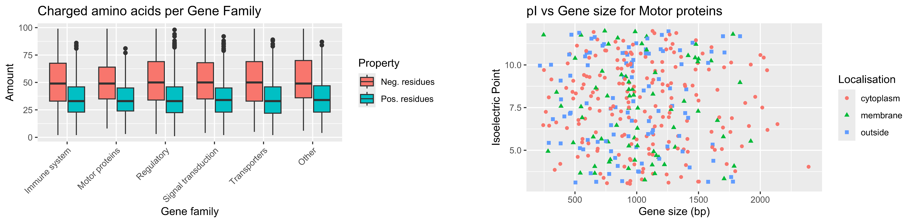

------------------------------------------------------------------------

[Go back to the main page](../index.html)\
[Go back to the R overview page](../R/R_01_index.html)

------------------------------------------------------------------------

```{r setup, include=FALSE}
knitr::opts_chunk$set(warning = FALSE, message = FALSE) 
```

# R

## Datasets to practice all topics of Data analysis & visualization

 <sub>Source: own work</sub>

In the data files below, you will find datasets that are generated by a
program and contain (partially fictional) biological data.

[dataset01](.add_datasets/dataset01.csv)

[dataset02](.add_datasets/dataset02.csv)

[dataset03](.add_datasets/dataset03.txt)

[dataset04](.add_datasets/dataset04.tsv)

[dataset05](.add_datasets/dataset05.tsv)

[dataset06](.add_datasets/dataset06.tsv)

[dataset07](.add_datasets/dataset07.txt)

[dataset08](.add_datasets/dataset08.tsv)

[dataset09](.add_datasets/dataset09.csv)

[dataset10](.add_datasets/dataset10.txt)

You can practice your 'R' skills with these datasets:

- load a dataset in R; check the separator first and decide which code
  you need to load the data in RStudio

- each dataset contains missing data; remove these from the dataset
  first before analysing and/or visualising in graphs

  - *HINT*: check columns that should have numbers, but contain
    character type data

- group data for different variables and use them for graphs, such as
  boxplots and barplots

- filter for certain conditions (*e.g.* Probability SP \> 0.7, #Exons \<
  10,...)

- use (statistical) calculations for several variables and for different
  groups (*e.g.* 'Gene family', 'Signal petpide', etc.) try to create
  the following graphs (including titles, axis titles, etc.):

- [Boxplot]{.underline}:

  - Mol. weight for monomers, dimers, trimers,....

  - Probability SP for signal peptides (SPI, SPII,....)

  - GC-content for Gene family

- [Barplot]{.underline} (with the Gene symbol on the x-axis):

  - Average Mol. weight for a particluar Gene family

  - Average isoelectric point for a localisation

- [XY-scatterplot]{.underline} (for only Motor proteins):

  - GC-content vs gene size

  - Gene size vs #exons for membrane proteins

  - Pos. residues vs Neg. residues for proteins containing a SPI signal
    peptide

*NOTE*: these analyses are not very meaningful biologically, but these
exercises are meant to help you analyse and visualize data in R.

The following datasets are useful for XY-scatterplots only. These
datasets are generated by a program, but do contain correlation between
the x- and y-values. The x-values are in the first column, the y-values
in the rest of the columns.

[dataset11](.add_datasets/dataset11.csv)

[dataset12](.add_datasets/dataset12.csv)

[dataset13](.add_datasets/dataset13.txt)

[dataset14](.add_datasets/dataset14.tsv)

[dataset15](.add_datasets/dataset15.tsv)

The files are in different formats (csv, txt, tsv,...), so you will have
to figure out how to load these data in RStudio.

Later on, some examples of analyses and graphs will be provided.

------------------------------------------------------------------------

[Go back to the main page](../index.html)\
[Go back to the R overview page](../R/R_01_index.html)\
<a href="#top">⬆️ Back to Top</a>

------------------------------------------------------------------------

> This web page is distributed under the terms of the Creative Commons
> Attribution License which permits unrestricted use, distribution, and
> reproduction in any medium, provided the original author and source
> are credited. Creative Commons License: CC BY-SA 4.0.
